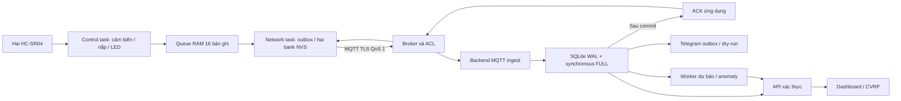

# Kiến trúc và hợp đồng dữ liệu v1

## Tách trách nhiệm



Control task core 1 priority 3 sở hữu servo/trạng thái, không gọi Wi-Fi/MQTT/HTTP/NVS. Network task core 0 priority 1 quản lý mạng và Flash. Trao đổi bằng FreeRTOS queue; metrics dùng mutex rất ngắn, không giữ mutex khi I/O. ESP-MQTT có task riêng. Backend ingest không gọi ML/Telegram đồng bộ. SQLite mở connection riêng cho mỗi thao tác; `BEGIN IMMEDIATE` serialize ingest, unique constraint bảo vệ khi retry đồng thời.

## Schema

Các trường bắt buộc: `version=1`, `bin_id`, `boot_id`, `boot_no`, `seq`, `kind`, `source`, `sampled_at`, `time_quality`, `uptime_ms`, `fill_pct`, `distance_cm`, `quality`, `lid_state`, `lid_open_count`. `event_type` bắt buộc với `kind=event`, không có giá trị với telemetry. Các trường metrics có mặc định 0. `full_on_pct/full_off_pct` mặc định 80/75 và phải có `off < on`. Firmware lưu cả ngưỡng trong snapshot để replay sau đổi cấu hình vẫn giữ nội dung cũ.

```json
{"version":1,"bin_id":"bin-001","boot_id":"00000002-1234abcd","boot_no":2,"seq":17,"kind":"event","event_type":"FULL","source":"real","sampled_at":"2026-11-17T03:00:00Z","time_quality":"sntp","uptime_ms":60000,"fill_pct":83.0,"distance_cm":8.42,"quality":"valid","lid_state":"CLOSED","lid_open_count":4,"battery_mv":null,"full_on_pct":80.0,"full_off_pct":75.0,"queue_depth":2,"dropped_records":0,"reconnects":1,"offline_ms":0}
```

Đây là **ví dụ**, không phải dữ liệu đã đo. `lid_open_count` đếm số lệnh bắt đầu mở, kể cả mở lại khi đang đóng, reset về 0 mỗi boot; không đo số lượt bỏ rác. `uptime_ms` dùng `esp_timer_get_time()` 64 bit. Deadline cục bộ dùng hiệu `uint32_t(now-then)`, chống tràn millis; các khoảng cấu hình phải dưới nửa miền uint32.

`sampled_at=null` đi cùng `time_quality=unknown`; không thay bằng giờ server. `received_at` do backend ghi riêng. Giờ có timezone, không vượt server hơn 5 phút. `quality=valid` phải có mức đầy 0–100 và khoảng cách 2–400 cm; các quality khác phải `fill_pct=null`. Không tự tạo giá trị dòng/pin/hành trình. `battery_mv=null` vì chưa có đo pin. `FULL/CLEARED` chỉ chấp nhận khi valid và phù hợp ngưỡng trong snapshot. Không nhận NaN/Infinity, field lạ, payload >2048 byte.

Các quality: `warming` chưa đủ cửa sổ; `stale` lần đo hỏng/chưa mới; `fault` lỗi liên tiếp; `lid_open` chưa thể kết luận do nắp/ổn định; `valid` số đo sử dụng được. Trạng thái nắp là ước lượng từ lệnh/thời gian khi không có hành trình, không được gọi là phản hồi vị trí thật.

## Topic và xác nhận

| Topic | Chủ thể publish | Quyền subscribe | QoS / retain |
|---|---|---|---|
| `v1/bins/{bin_id}/telemetry` | Username đúng bin_id | Backend | 1 / false |
| `v1/bins/{bin_id}/events` | Username đúng bin_id | Backend | 1 / false |
| `v1/bins/{bin_id}/ack` | Backend | Chính thiết bị đó | 1 / false |

Backend kiểm tra topic khớp payload, thùng đã đăng ký, nguồn đúng registry, tối đa 120 bản tin/phút/thùng. Credential và ACL là nơi ràng buộc username với topic; chỉ kiểm tra `bin_id` trong JSON không đủ xác thực thiết bị.

ACK: `{"bin_id":"bin-001","boot_id":"...","seq":17,"stored":true,"duplicate":false}`. Trả cả khi nhận lại bản tin đã lưu cùng nội dung. ACK được publish sau khi `ingest()` thoát transaction commit. PUBACK chỉ xác nhận chặng broker; không xóa sự kiện dựa trên PUBACK. ACK cũng không đồng nghĩa Telegram đã nhận. Backend crash giữa commit và ACK → retry → dedup → ACK lại.

## Ordering, reset và thời gian

NVS namespace `binboot` lưu `boot_no`, tăng và xác nhận ghi thành công **trước** tạo task/servo. Không ghi được thì dừng khởi tạo thiết bị và log lỗi. `boot_id` gồm boot_no và số ngẫu nhiên. `seq` tăng từ 1, không quay vòng: hết uint32 thì ngừng tạo bản tin và báo lỗi lưu trữ. Sự kiện đã persist giữ nguyên boot/seq/nội dung sau reset.

Trạng thái mới nhất chọn theo `(boot_no,seq)` của **cùng mã thiết bị**, không theo UUID hay thứ tự nhận. Hai boot_id cùng boot_no hoặc cùng boot_id khác boot_no bị từ chối. Xóa/thay chip NVS có thể reset counter: phải cấp mã thùng mới và credential mới, hoặc làm quy trình migration được kiểm soát; hiện không có endpoint reset counter. NVS không bị chương trình tự format/xóa.

Không có đồng hồ vẫn phân biệt phiên cũ/mới bằng boot_no bền vững. Payload chưa biết giờ lưu lịch sử nhưng bị gắn stale/unusable cho AI/routing mặc định. Replay cũ không cập nhật `last_seen` của trạng thái mới và không làm thiết bị sống lại; một chuỗi ID cũ trùng nhau không được tính là heartbeat mới. `online` chỉ phản ánh nhận một trạng thái tiến lên trong 360 giây, không chứng minh cảm biến đúng. `stale` xét tuổi **giờ đo**, độc lập online. `delivery_delay_seconds=received_at-measured_at` khi biết giờ; gửi bù chưa biết giờ thì độ trễ không xác định, không bịa số.

## CSDL

Schema v1 được tạo idempotent trong `backend/db.py`, có bảng `schema_version`. Chưa có migration phá vỡ schema; thay đổi cấu trúc tương lai cần migration mới, không xóa DB để nâng cấp.

`bins`: registry tọa độ, capacity_l, nguồn bất biến. `boots`: ràng buộc boot. `telemetry`: mọi bản tin, unique `(bin_id,boot_id,seq)`, measured/received/quality/source và snapshot JSON. `events` tham chiếu bản tin; `bin_state` giữ phiên bản mới nhất và hysteresis. `predictions` là cache kết quả có hiệu lực. `outbox` giữ công việc cảnh báo bền vững. `users`, `sessions`, `kv` cho auth/cooldown/offset. Chỉ mục `(bin_id,measured_at)` phục vụ lịch sử.

Sự kiện cũ gửi bù vẫn được lưu và có công việc thông báo mang nhãn **lịch sử có thể gửi bù**, không tuyên bố thùng hiện đang đầy. Backstop backend chốt đầy sau 3 telemetry hợp lệ đạt ngưỡng, không phụ thuộc AI. Nếu đổi ngưỡng thì reset số đếm xác nhận; latch chỉ xóa sau đủ xác nhận ở ngưỡng mới hoặc CLEARED hợp lệ. Mỗi bản tin ingest/outbox được tạo trong cùng transaction.

## API

| Endpoint | Quyền | Mục đích |
|---|---|---|
| `GET /health` | Không đăng nhập | Chỉ health tối thiểu, không thông tin credential |
| `POST /api/login`, `/api/logout` | Login / phiên hợp lệ | Cookie HttpOnly, SameSite Strict, hạn 8h |
| `GET /api/me`, `/api/health` | Viewer | Danh tính/health có giới hạn |
| `GET /api/bins` | Viewer | Trạng thái, nguồn, chất lượng, tuổi dữ liệu, dự báo |
| `POST /api/bins` | Manager | Đăng ký/cập nhật metadata; không đổi source |
| `GET /api/bins/{id}/history` | Viewer | start/end Unix seconds, limit ≤5000 |
| `GET /api/bins/{id}/events` | Viewer | 200 sự kiện gần nhất, có measured/received/source |
| `POST /api/demo/ingest` | Manager | Chỉ thùng registered simulated; real bị từ chối |
| `POST /api/routes` | Manager | Depot, vehicles, capacity_l, threshold, time limit, source, chính sách unknown |
| `GET /api/export?bin_id=...` | Manager | JSONL giữ source/giờ nhận, tối đa 5000 bản ghi/lần |

Không có endpoint nạp model hoặc điều khiển servo từ Internet. API không bật CORS toàn cục; Origin khác bị từ chối ở request thay đổi trạng thái. Payload HTTP ≤4096 byte; riêng ingest ≤2048. Login giới hạn 10 lượt/phút/IP; tuyến serialize một job, cooldown 5 giây/user và solver tối đa 10 giây. Các giới hạn này dành cho demo local, không thay thế gateway/rate limit phân tán khi mở rộng công khai.
